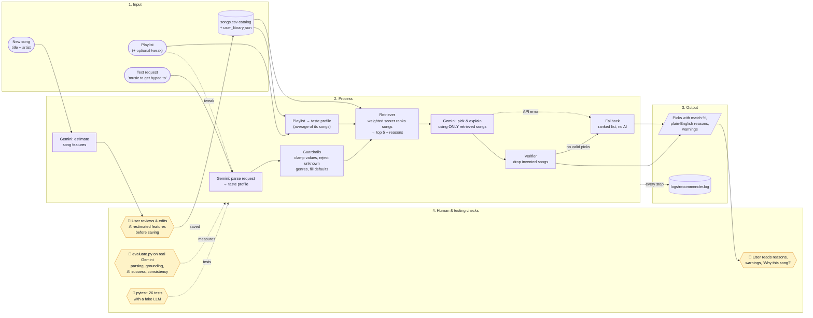

# 🎵 Vibenator 6000: AI Music Recommender

Vibenator 6000 recommends music from a plain-English request like *"sad acoustic songs for a rainy day"*, or from a playlist you've built. It combines a large language model (Google Gemini) with a transparent, hand-tuned scoring engine. Gemini understands what you're asking for and explains its picks, but the songs always come from a real catalog search, and a verifier removes any song the model tries to invent.

**Why it matters:** recommendation systems often feel like black boxes, and LLMs sometimes make things up. This project shows one way to get both helpful language *and* trustworthy results: retrieval-augmented generation (RAG) grounded in a scoring system you can inspect, with guardrails, fallbacks, logging, and automated tests at every step.

---

## Original Project: Music Recommender Simulation (Module 3)

This project grew out of my **Music Recommender Simulation** from Module 3. That version was a content-based recommender: it scored each of 20 songs against a hand-written taste profile (favorite genre and mood, plus target energy, acousticness, valence and instrumentalness) using weighted rules, then returned the top 5 with a point-by-point explanation. Its goal was to show how recommenders turn data into predictions, and where bias comes from in weights and data. The full design notes and stress-test experiments are in [docs/original-project.md](docs/original-project.md).

## What's New in the Final Version

- **RAG pipeline:** Gemini turns free text into a taste profile, the original scoring engine retrieves the best matches, and Gemini picks and explains songs using **only** those retrieved results.
- **Playlists and your own songs:** build playlists, and the app learns a taste profile from them. Add any song by title and artist; Gemini estimates its features and you review them before saving.
- **Streamlit web app:** tabs for Discover, My Playlists and Add a Song, plus a **Mood mode** background that changes color with the music's energy and mood (optionally animated to the song's tempo).
- **Plain-English results:** a match % and reasons like "✓ Same genre (rock)" by default, with a toggle to show the raw numbers.
- **Reliability:** input and output guardrails, retries with timeouts, a non-AI fallback, step-by-step logging, 26 unit tests, and an evaluation script that measures the live AI.

---

## Architecture Overview



Source files: [diagrams/architecture.mmd](diagrams/architecture.mmd) (this overview) and [diagrams/architecture-detailed.mmd](diagrams/architecture-detailed.mmd) (every module and function).

1. **Input.** The user gives a text request, picks a playlist (optionally with a tweak like *"but more acoustic"*), or adds a new song. Songs come from the 20-song catalog plus the user's own saved songs.
2. **Process.**
   - For a text request, Gemini turns the words into a taste profile, and guardrails make it safe: values are clamped to 0–1, genres that aren't in the catalog are dropped, and missing values get defaults.
   - For a playlist, the profile is the average of its songs' features.
   - Either way, the **retriever** (the original weighted scoring engine) ranks every song and passes the top 5, with their score reasons, to Gemini.
   - Gemini picks and explains its favorites, and the **verifier** drops any song that wasn't retrieved.
   - If Gemini fails or returns nothing valid, the system falls back to the ranked list.
3. **Output.** The user sees picks with a match %, plain-English reasons and any warnings. Every step is written to a log file.
4. **Checks.**
   - **Humans:** you review and edit AI-estimated song features before they're saved, and you can see why each song was picked.
   - **Automated:** pytest checks the pipeline with a fake LLM, and `src/evaluate.py` measures the real model.

---

## Setup

Requires Python 3.10 or newer. Run every command from the project folder.

1. **Get the code and create a virtual environment:**

   ```bash
   git clone https://github.com/markkubrak/applied-ai-system-project.git
   cd applied-ai-system-project
   python -m venv .venv
   source .venv/bin/activate          # Mac / Linux
   .venv\Scripts\Activate.ps1         # Windows PowerShell
   ```

   Your prompt should now start with `(.venv)`. On Windows, if PowerShell refuses to run the activate script, run `Set-ExecutionPolicy -Scope CurrentUser RemoteSigned` once.

2. **Install dependencies:**

   ```bash
   pip install -r requirements.txt
   ```

3. **Add a Gemini API key.** Get a free key at https://aistudio.google.com/apikey, copy the example file, and paste your key into `.env`:

   ```bash
   cp .env.example .env               # Mac / Linux
   copy .env.example .env             # Windows
   ```

   Without a key everything still runs, but recommendations use the non-AI fallback.

4. **Run it:**

   ```bash
   streamlit run app.py                                        # web app (opens in your browser)
   python -m src.main --ask "sad acoustic songs for a rainy day"   # one request in the terminal
   python -m src.main                                          # type requests one at a time
   python -m src.main --playlist Chill --tweak "but with vocals"   # recommend for a saved playlist
   python -m src.main --profiles                               # original Module 3 demo (no AI)
   ```

   Use `python -m src.main`, not `python main.py`: the code lives in the `src` package.

5. **Test it:**

   ```bash
   pytest                     # 26 unit tests, no API key needed
   python -m src.evaluate     # reliability evaluation against the real Gemini API
   ```

---

## Sample Interactions

These are real outputs from the command-line version (`python -m src.main`). The web app shows the same results as cards with a match % and plain-English reasons.

### 1. Text request, answered by Gemini

**Input:** `python -m src.main --ask "sad acoustic songs for a rainy day"`

Gemini parsed the request into *genre: folk, mood: sad, energy 0.2, acousticness 0.9, valence 0.2, instrumentalness 0.1*. The scorer retrieved Paper Boats, Empty Station Blues, Moonlit Sonata Redux, Coffee Shop Stories and Spacewalk Thoughts. Gemini then picked three of them:

```
Request: sad acoustic songs for a rainy day
Mode: AI (Gemini + retrieval)
Here are a few gentle, melancholic acoustic tracks that perfectly capture the mood of a quiet rainy day.
1. Paper Boats by Ember & Oak  [folk, melancholic]
   Its melancholic folk sound combines high acousticness with low energy and valence, making it an ideal match for a sad rainy afternoon.
2. Empty Station Blues by Hank Marlowe  [blues, sad]
   This track delivers a distinctly sad blues mood backed by rich acoustic instrumentation and very low valence.
3. Moonlit Sonata Redux by Clara Vey  [classical, peaceful]
   With exceptionally high acousticness and quiet energy, this peaceful classical piece fits a reflective, somber ambiance.
```

Every pick is one of the five retrieved songs, and each reason is based on the score details the retriever gave Gemini.

### 2. Text request: high energy

**Input:** `python -m src.main --ask "music to get hyped to at the gym"` (model: `gemini-3.5-flash-lite`, see Testing Summary)

```
  ... Understanding your request...
  ... Searching the catalog...
  ... Writing recommendations...
Request: music to get hyped to at the gym
Mode: AI (Gemini + retrieval)
Profile from request:
  genre: edm | mood: intense
  energy 0.95 | acousticness 0.10 | valence 0.80 | instrumentalness 0.20 | discovery 0.50

AI picks: Here are some high-energy tracks to get you hyped and crushing your gym goals.
1. Neon Overdrive by Pulsewave  [edm, euphoric]  score 5.10
   It's a top match with an incredible edm genre alignment and super high energy of 0.96.
2. Gym Hero by Max Pulse  [pop, intense]  score 4.32
   This pop track fits the intense gym mood perfectly and boasts a high popularity score of 92.
3. Storm Runner by Voltline  [rock, intense]  score 4.24
   It delivers the right intense mood match along with high energy to keep your workout going strong.

Retrieved by weighted scoring (top 5, max 6.75; * = picked):
 *1. Neon Overdrive by Pulsewave  score 5.10
 *2. Gym Hero by Max Pulse  score 4.32
 *3. Storm Runner by Voltline  score 4.24
  4. Sunrise City by Neon Echo  score 3.14
  5. Iron Requiem by Grave Hollow  score 3.10
```

Compare this with Sample 1: the same pipeline turned a very different request into the opposite profile (energy 0.95 instead of 0.2), and again Gemini only picked from the retrieved songs.

### 3. Playlist recommendation when Gemini is unavailable (fallback)

**Input:** `python -m src.main --playlist Chill --tweak "but with vocals"`, run while the Gemini daily quota was used up.

The taste profile is learned from the 4 songs in the playlist, with no AI needed. Songs already in the playlist are excluded. Because Gemini couldn't read the tweak, the app said so and returned the top weighted matches instead of failing:

```
Playlist 'Chill': 4 songs
  ... Understanding your request...
  ... Searching the catalog...
  ... Writing recommendations...
Mode: Fallback (ranked list, no AI)
Profile from playlist 'Chill':
  genre: (any) | mood: chill
  energy 0.28 | acousticness 0.92 | valence 0.46 | instrumentalness 0.73 | discovery 0.74

Top picks: Here are the closest matches from the catalog.
1. Midnight Coding by LoRoom  [lofi, chill]  score 4.01
2. Coffee Shop Stories by Slow Stereo  [jazz, relaxed]  score 3.09
3. Focus Flow by LoRoom  [lofi, focused]  score 3.08

Notes:
  - could not understand request (Gemini is overloaded or rate-limited right now; ...)
  - could not generate answer (...); using ranked list
```

This shows the guardrails doing their job. It also shows the fallback's limit: the "with vocals" tweak was ignored, so mostly instrumental songs were returned.

---

## Design Decisions and Trade-offs

- **RAG instead of fine-tuning.** The catalog is small and changes whenever a user adds a song, so retraining a model makes no sense. Retrieving first and then generating keeps the AI's answers tied to real songs.
  - *Trade-off:* the AI can only be as good as what the retriever finds.
- **The original weighted scorer is the retriever.** I kept my Module 3 scoring engine instead of switching to embeddings. Its scores can be explained feature by feature, tested exactly, and shown to the user ("Energy: very close to what you want").
  - *Trade-off:* it only understands the features I defined. It can't tell that "chill" and "relaxed" are similar moods.
- **The LLM is boxed in on both sides.**
  - On the way in, guardrails clamp and validate whatever Gemini returns before it reaches the scorer.
  - On the way out, the verifier throws away any song that wasn't retrieved.
  - *Trade-off:* sometimes the model's creativity gets thrown away along with its mistakes.
- **Gemini estimates song features, and a human checks them.** Real audio features would be better, but Spotify's audio-features API is closed to new apps. So Gemini makes an educated guess, flags songs it doesn't recognize, and the user can edit every value before saving.
  - *Trade-off:* estimates for obscure songs are guesses.
- **A playlist's taste is the average of its songs.** This is simple and explainable, and it reuses the existing scorer without changes. A tie between genres means "no genre preference", so the scorer doesn't give a false bonus.
  - *Trade-off:* a mixed playlist, half metal and half lofi, averages out to "medium" and fits neither.
- **There's always an answer.**
  - If the API key is missing, the API returns an error, the model is overloaded, or its output is invalid, the app falls back to the ranked list and says why.
  - API calls retry temporary errors and time out after 25 seconds, and progress messages show while the app waits.
  - *Trade-off:* the fallback answers are less personal.
- **Streamlit for the interface.** It's fast to build and pure Python.
  - *Trade-off:* less control over layout and interaction. I had to work around how Streamlit refreshes the page to fix some double-click bugs.
- **Model choice:** `gemini-3.8-flash` with low "thinking" by default, for speed on short, structured tasks. It can be changed with `GEMINI_MODEL` in `.env`. The free tier limits each model separately (`gemini-3.8-flash` allows 20 requests per day), so I ran the final samples and evaluation on `gemini-3.5-flash-lite`, which has its own quota. Lighter models are cheaper and faster, at some cost in judgment.

---

## Testing Summary

**Automated tests: 26 pass.** They run with a fake LLM, so they need no API key and give the same result every time.
- `tests/test_ai_recommender.py`:
  - the answer is grounded in the retrieved songs
  - invented songs are dropped
  - when every pick is invented, the app falls back to the ranked list
  - API errors fall back safely
  - out-of-range values are clamped
  - JSON wrapped in code fences is parsed
  - empty requests are rejected
  - progress messages are reported
  - a daily-quota error is reported clearly
- `tests/test_library.py`:
  - playlist profiles average their songs
  - tied genres give no genre preference
  - duplicate songs are skipped
  - a corrupted library file is backed up and recovered
  - songs already in the playlist are excluded from recommendations
  - a tweak blends with the playlist profile
  - estimated features are clamped
  - estimation falls back to manual entry on API errors
- `tests/test_explain.py`: match %, word levels and plain-English reasons.
- `tests/test_recommender.py`: the original Module 3 scoring tests.

**Web app checks:** I used Streamlit's headless test tool (`AppTest`) to script real interactions:
- creating playlists
- switching between them with one click
- checking that the background color changes immediately
- adding a song with one click
- delete → Cancel keeps the playlist, Delete removes it
- the numbers toggle

**Live AI evaluation (`python -m src.evaluate`):**

The script sends 6 fixed requests, plus 2 repeats for consistency (about 16 Gemini requests). It checks that:
- the parsed profile points the right way (for example, "lifting weights" → energy ≥ 0.75)
- every pick was actually retrieved
- the AI path was used rather than the fallback
- repeated requests return the same top pick

Real run with `gemini-3.5-flash-lite` (the default `gemini-3.8-flash` had used up its free daily quota):

```
[PASS] calm lofi beats to study to, no vocals          top pick: Focus Flow
[PASS] loud aggressive music for lifting weights       top pick: Iron Requiem
[PASS] sad acoustic songs for a rainy day              top pick: Paper Boats
[PASS] happy upbeat pop for a road trip                top pick: Sunrise City
[PASS] obscure underground tracks nobody has heard of  top pick: Empty Station Blues
[FAIL] k-pop for a dance party                         top pick: Velvet Hours
       parsing: target_energy=0.5 not in [0.6, 1.0]

Summary
  parsing      5/6  (83%)
  grounding    6/6  (100%)
  ai_used      6/6  (100%)
  consistency  2/2  (100%)
```

**About the one failure:** the log shows the k-pop request hit the free tier's limit of 15 requests per minute, so parsing fell back to default preferences. A later recommendation step still succeeded, which is why "AI used" is 6/6. When I reran it a minute later, Gemini parsed it as *genre: pop, mood: euphoric, energy 0.9* and picked Gym Hero and Sunrise City. The energy was right, but Gemini mapped "k-pop" to the closest catalog genre, "pop", instead of leaving the genre blank as my test expected. That's arguably a better answer than my test's expectation, which suggests the test case should allow either. The fixes:
- pause between evaluation requests to stay under the per-minute limit
- make the retry wait longer for per-minute rate limits

**What didn't work at first, and what I learned:**
- **Retired model.** The first model I used, `gemini-2.5-flash`, returned a 404 because it's no longer available to new users. Reading the error message pointed to the replacement.
- **Overloaded API.** Gemini often returned 503/504 "high demand" errors and calls hung for over a minute. I added retries with backoff, a 25-second timeout and visible progress messages. The fallback meant the app kept working, but it also showed me that "it works" depends on a service I don't control.
- **The "overload" was partly a quota.** Many failures turned out to be `429 RESOURCE_EXHAUSTED`: the free tier allows only 20 requests per day, and my own testing used it up. The app was also retrying these errors, which wasted time. Now a daily-quota error isn't retried and shows a clear message, and the evaluation script uses fewer requests. The lesson: read the full error message before guessing the cause.
- **Double clicks in the web app.** Switching playlists and adding songs sometimes needed two clicks. Both came from Streamlit's refresh model: a widget whose selection was set from saved state reset itself, and a change was saved without redrawing the page.
- **Mood colors that didn't differ.** My Chill and Hype playlists produced nearly the same background color, because the color was based on happy-vs-sad (valence) and both playlists had similar valence. Mapping energy to the color fixed it. The lesson: test with realistic data, not just whether the code runs.
- **A test that almost deleted real data.** One of my test scripts would have deleted the user's saved playlists. The library location can now be overridden with `MUSIC_LIBRARY_PATH`, so tests always use a temporary file.

---

## Limitations

- The catalog has only 20 fictional songs, mostly one per genre, so some tastes have few good matches.
- Song features estimated by Gemini can be wrong, especially for songs it doesn't recognize. That's why they're shown for review before saving.
- A playlist's taste is an average, so mixed playlists produce "middle of the road" profiles.
- Genre and mood matching is exact text matching ("chill" and "relaxed" count as different).
- The AI features depend on Gemini being available. When it isn't, results fall back to the less personal ranked list.

More detail on intended use, bias and limitations is in the [model card](model_card.md).

---

## Reflection

This project taught me that AI truly isn't perfect, and that testing the app yourself and confirming the changes your AI made still has real value. I found myself going back and forth to see if it actually did what I asked it to do. 
The better your initial set up is, the easier it is to continue working. I even had a small moment where I needed to refactor because of a major feature that I added (for example changing all the weight numbers to something easily readable).
I also got to see additional features of Claude, how it prompts the user in multi-steps on what the user wants, which was helpful and often times I had to add on top of what Claude wanted to do.

---

## Project Structure

```
app.py                     Streamlit web app
src/ai_recommender.py      Gemini client, RAG pipeline, guardrails, feature estimation
src/recommender.py         Weighted scoring engine (the retriever, from Module 3)
src/library.py             User songs, playlists, playlist → taste profile
src/explain.py             Plain-English match % and reasons
src/main.py                Command-line interface
src/evaluate.py            Live reliability evaluation
tests/                     Unit tests (fake LLM, no API key needed)
data/songs.csv             Song catalog
diagrams/                  Mermaid architecture diagrams
docs/original-project.md   Module 3 design notes and experiments
model_card.md              Model card
```
